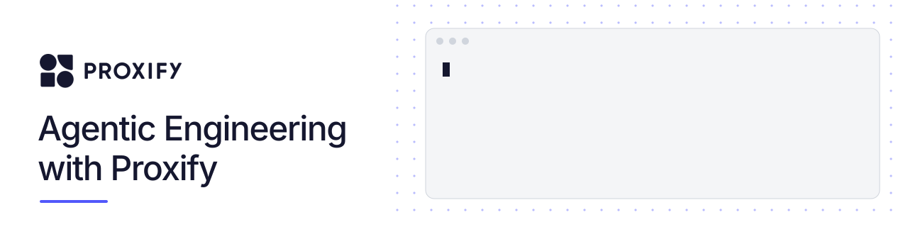

<picture><source media="(prefers-color-scheme: dark)" srcset="https://raw.githubusercontent.com/proxify-hackathons/.github/main/profile/banner-dark.svg?v=4"></picture>

## Agentic Engineering with Proxify

A five-day solo hackathon for developers in the Proxify network. Pick one of two challenges and build it with coding agents.

**[Apply and choose a challenge →](https://hackathons.proxify.io/hackathons/agentic-engineering-with-proxify)**

### The challenges

**Learning paths**

Build a service that takes a developer's current skills and a goal, such as a role, a project or a new stack, and returns a personal learning path they can work through step by step. You build it with coding agents, in a stack outside your own.

**Agent that learns**

Give your coding agent a memory for a project, so you never say the same thing twice. You build it as a Claude Code plugin: it keeps what was agreed and why, ends a rule when it stops applying, and brings the right part back at the right moment in a later session.

### Timeline

All times CET.

| When | What happens |
|---|---|
| **Monday, November 30, 09:00** | Registration opens. Apply with the email you use in the Proxify network and pick a challenge. |
| **Thursday, December 3, 12:00** | Registration closes. Your challenge is locked in. |
| **Friday, December 4, 09:00** | Kick-off. Your challenge's full brief and starter kit open, and you start building. |
| **Wednesday, December 9, 09:00** | Submission deadline. Submit your entry in the hackathons app before then. |
| **December 9–14** | Scoring. We score every entry. |
| **Monday, December 14, 12:00** | Results. We publish the winners, and you see your own score and feedback. |

Questions? Ask in the #hackathon channel in the network Slack.

---

Made at Proxify · <a href="https://proxify.io">proxify.io</a>

